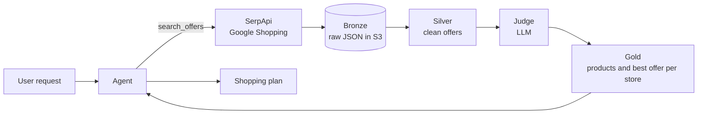

# Price Scout

Price Scout compares prices across online stores. You write what you want to buy in plain words, and an AI agent searches Google Shopping, drops the wrong listings, groups the same product sold by different stores and builds a shopping plan.

Example request:

> A mechanical ABNT2 keyboard, a wireless Logitech mouse and a 27-inch monitor. All pink.

For each item, the app shows the product it picked, why it picked it, the price in every store and how much you save by buying from the cheapest one. When it cannot find an exact match, it picks the closest product and says what is different.

It works for anything sold online: electronics, books, food, supplements, furniture, beauty products and more. Prices are in the currency of the chosen country.


## Contents

- [How it works](#how-it-works)
- [Stack](#stack)
- [Data layers](#data-layers)
- [The agent and the judge](#the-agent-and-the-judge)
- [Business rules](#business-rules)
- [Measuring quality](#measuring-quality)
- [Observability](#observability)
- [Running with Docker](#running-with-docker)
- [Configuration](#configuration)
- [Running without Docker](#running-without-docker)
- [Tests and CI](#tests-and-ci)
- [Project structure](#project-structure)
- [Known limits](#known-limits)

## How it works



1. The user sends a request with a country, an optional budget and optional preferences (brand, color, material, payment).
2. The agent plans a budget for each item and searches for all items at the same time.
3. Each search calls SerpApi. The raw answer is saved as a bronze file.
4. Silver turns the raw answer into clean offers: one row per listing, with price, store and link, without duplicates.
5. The judge, a second LLM call, removes listings that do not fit (accessories, used items, other products) and groups the listings that are the same product.
6. Gold computes the lowest price of each product and keeps the cheapest offer of each store.
7. The agent picks one product per item and returns the plan. Totals and savings are computed in code, not by the model.

## Stack

| Part | Tools |
|---|---|
| API | Python 3.12, FastAPI, Pydantic, uv |
| AI | OpenAI Responses API (agent with tool calls and an LLM judge) |
| Search | SerpApi (Google Shopping) |
| Data | DuckDB, dbt (dbt-duckdb), S3 (LocalStack on your machine) |
| Web | React, TypeScript, Vite, Tailwind CSS |
| Quality | pytest, ruff, mypy (strict), Vitest, dbt tests |
| Delivery | Docker Compose, GitHub Actions |

## Data layers

The data follows a medallion layout.

| Layer | Where | What it holds |
|---|---|---|
| Bronze | `s3://price-scout-lake/bronze/{search_id}.json` | The raw SerpApi answer, one file per search per day |
| Silver | dbt model `silver_offers` | Clean offers: title, store, price, link, image, installments |
| Gold | dbt models `gold_products`, `gold_product_offers` | Products with their lowest price and number of stores, and the best offer of each store |
| Gold (monitoring) | `gold_llm_usage_daily`, `gold_llm_versions`, `gold_agent_runs`, `gold_agent_tool_steps`, `gold_search_stages` | Cost, tokens, latency and timing of the agent |

The silver logic lives in one dbt macro, `silver_offers_from`. dbt applies it to every bronze file. The API applies the same macro, and the same gold model files, to the single file of the search it is running. This keeps one definition of the data and keeps each search fast, because it does not read the whole lake.

Bronze also works as a cache. The search id includes the date, so the same query on the same day is never paid twice, and a new day fetches fresh prices.

## The agent and the judge

The agent has four tools:

| Tool | What it does |
|---|---|
| `plan_budget` | Splits the budget between the items |
| `search_offers` | Searches one item and returns the products found, the ones matching the user's preferences first |
| `category_metrics` | Returns the usual price of a category, to spot prices that are too low to be real |
| `check_fit` | Checks if a piece of furniture fits a given width |

Searches asked in the same turn run in parallel.

The judge reads the listings of one search and answers with structured JSON, validated by Pydantic: which listings to drop and why, and which listings are the same product.

Prompts are versioned files in `api/src/price_scout/infrastructure/llm/prompts/` (`agent_v7.md`, `judge_v2.md` and older versions). The version in use is set in `.env`, and every model call records which version it used.

## Business rules

Some rules are written as files the system reads, not as code:

- `business_context.yml` is a glossary for the judge. It explains what makes two listings the same product (size, capacity, dose, quantity, color, flavor) and what to always drop (accessories, refurbished items, services).
- `store_policy.yml` lists stores that never reach the plan, per country. By default it blocks cross-border marketplaces such as AliExpress and Temu. Each country can block more stores or allow some back. These listings are dropped in code, before the judge, so the model never sees them.

Both files are in `api/src/price_scout/infrastructure/context/`.

## Measuring quality

The judge is measured against labeled cases in `api/evals/cases/`. Each case is a real or realistic search with the expected answer: which listings to drop and which ones are the same product.

The evaluation reports:

- decision accuracy: listings the judge kept or dropped correctly;
- discard F1: how well it finds the listings to drop;
- grouping F1: how well it puts the same product together.

It runs every case twice, with and without the business glossary, to show what the glossary adds. A case that fails to run counts as wrong answers and fails the whole run, so errors never raise the score.

```bash
cd api
uv run python -m evals.run                                  # with and without the glossary
uv run python -m evals.run --variant glossary --min-f1 0.8  # fails below 0.8
```

Each run calls the OpenAI API and costs a few cents. Results are saved in `api/evals/results/` and appear on the Observability page.

## Observability

Every model call is logged with the task (agent or judge), model, prompt version, tokens, cost, latency and errors. Every search records how long each stage took: fetch, silver, judge and gold.

dbt turns these logs into gold models, and the Observability page shows:

- runs, success rate, average and p95 duration, cost per request;
- tokens and cost per day;
- calls, cost and latency per model and prompt version;
- time per tool and per search stage;
- recent failures;
- judge accuracy, with the effect of the glossary.

Each request page also shows its own agent steps and model calls.

## Running with Docker

You need Docker, a [SerpApi](https://serpapi.com) key and an [OpenAI](https://platform.openai.com) key.

```bash
git clone https://github.com/aldamonique/price-scout-ai.git
cd price-scout-ai
cp .env.example .env
```

Fill in `SERPAPI_KEY` and `OPENAI_API_KEY` in `.env`, then:

```bash
docker compose up -d --build
```

This starts, in order:

1. `localstack`: a local S3 with the `price-scout-lake` bucket;
2. `seed-lake`: creates the database tables and copies `data/bronze/` into the bucket;
3. `dbt`: runs `dbt build` (models and tests);
4. `api`: the API at http://localhost:8000 (docs at http://localhost:8000/docs);
5. `web`: the app at http://localhost:8080.

Every search is also saved to `data/bronze/` on your machine. If the LocalStack container is recreated, the next start copies those files back into the bucket.

Useful commands:

```bash
docker compose logs -f api            # follow the API logs
docker compose up -d --build web      # rebuild the app after a frontend change
docker compose down                   # stop everything (data is kept)
```

## Configuration

All settings live in `.env`. The main ones:

| Variable | What it is |
|---|---|
| `SERPAPI_KEY`, `OPENAI_API_KEY` | API keys |
| `AGENT__MODEL`, `JUDGE__MODEL` | OpenAI models for the agent and the judge |
| `AGENT__REASONING_EFFORT`, `JUDGE__REASONING_EFFORT` | Reasoning effort of each model |
| `AGENT__INPUT_USD_PER_MTOK`, `AGENT__OUTPUT_USD_PER_MTOK` (and `JUDGE__...`) | Prices used to compute cost |
| `AGENT__PROMPT_VERSION`, `JUDGE__PROMPT_VERSION` | Prompt versions in use |
| `LAKE__BACKEND` | `local` (files in `data/bronze/`) or `s3` (Docker sets this for you) |
| `MAX_REQUESTS_PER_HOUR` | Limit of new requests per hour, to cap spending |
| `ADMIN_TOKEN` | When set, deleting requests and reading observability need this token |
| `API_PORT`, `WEB_PORT` | Ports used by Docker (default 8000 and 8080) |

## Running without Docker

Useful to work on one part. Without Docker, bronze files go to `data/bronze/`.

API:

```bash
cd api
uv sync
uv run python scripts/init_warehouse.py
uv run uvicorn price_scout.main:app --reload
```

dbt, after the API has saved a few searches:

```bash
cd analytics
uv sync
uv run dbt build
```

Web app, with the API running on port 8000:

```bash
cd web
npm install
npm run dev
```

## Tests and CI

```bash
cd api && uv run pytest && uv run ruff check . && uv run mypy src tests scripts evals
cd web && npm test && npm run lint && npm run build
```

GitHub Actions runs on every push:

- `api`: ruff, mypy, pytest, and a check that the web app's copy of the API schema is up to date;
- `analytics`: loads sample bronze files (duplicates, missing prices, an empty search) and runs `dbt build`. In CI, empty models and judged offers missing from silver fail the build;
- `web`: checks that the TypeScript types match the API schema, then lint, tests and build;
- `judge-accuracy`: runs the evaluation on demand and fails below F1 0.8.

The web app validates every API response against the same OpenAPI schema, so a change in the API shows up as a clear error instead of broken screens.

## Project structure

```
price-scout-ai/
├── api/                    FastAPI app
│   ├── src/price_scout/
│   │   ├── domain/         models, rules and interfaces (no frameworks)
│   │   ├── application/    use cases: search, shopping requests, observability
│   │   ├── infrastructure/ OpenAI, SerpApi, DuckDB, S3, prompts, business rules
│   │   ├── presentation/   HTTP routes
│   │   └── bootstrap.py    wires everything together
│   ├── evals/              labeled cases and the evaluation runner
│   ├── scripts/            setup and maintenance scripts
│   └── tests/
├── analytics/              dbt project (silver, gold, tests, sample data)
├── web/                    React app
├── infra/localstack/       bucket setup for the local S3
├── data/                   local database and bronze copy (not in git)
├── docker-compose.yml
└── .github/workflows/ci.yml
```

The API follows a clean architecture: the domain only knows interfaces, and the real implementations (OpenAI, SerpApi, DuckDB, S3) are plugged in `bootstrap.py`. Caching and call logging are decorators around those implementations.

## Known limits

- SerpApi returns only the store name, not its website, so the store policy matches stores by name.
- The judge is one model call per search. A cheaper model would lower the cost; the evaluation is there to check it does not lower the accuracy.
- There are 13 labeled cases, written by one person. More cases would make the numbers more reliable.
- DuckDB allows one writer, so the API runs as a single process. A public service would need a queue and a server database.
- There are no user accounts. Anyone with the link can see the request history. `MAX_REQUESTS_PER_HOUR` and `ADMIN_TOKEN` limit cost and protect the admin pages.
